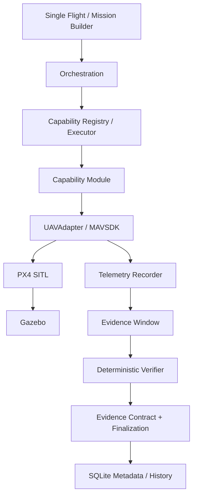

# Architecture

## Tổng quan



## Trust boundary

Authority được tách rõ:

- **Physics / flight stack**: PX4 SITL + Gazebo.
- **Measurement**: MAVSDK telemetry.
- **Capability implementation**: module điều khiển trong phạm vi capability.
- **Verdict**: deterministic Python verifier.
- **UI**: input + visualization, không chấm PASS/FAIL.
- **AI engineering plane**: hỗ trợ code/test/recovery, không nằm trong realtime flight loop.

## Capability layer

Capability generic gồm:

```text
CapabilityDefinition
CapabilityRegistry
CapabilityExecutor
Implementation module
Independent verifier
Evidence contract
```

Registered primitives:

- TAKEOFF-001
- NAV-001
- RETURN-HOME-001
- LAND-001

## Mission layer

MISSION-001 compose các capability nhưng không thay thế child verifier. MissionVerifier đọc child finalized evidence và kiểm tra sequence, integrity, continuity và terminal state.

## Evidence boundary

Nguyên tắc quan trọng:

```text
EXECUTION
→ stop/flush telemetry
→ freeze evidence
→ deterministic verification
→ post-action / next step
```

Do đó landing/post-action không thể sửa dataset đã dùng cho verdict.

## Data plane

- raw telemetry: disk evidence, verifier fidelity 10 Hz;
- live telemetry: bounded ring buffer;
- browser: incremental delta transport + gzip;
- historical metadata: SQLite;
- runtime evidence root: externalizable qua `UAV_DATA_DIR`;
- retention: manual, dry-run first, pinned attempts protected.

## Runtime ownership

Single Flight và Mission Builder dùng chung simulation supervisor để tránh hai owner thao tác cùng container. Mutual exclusion chặn hai execution mode command vehicle đồng thời.
